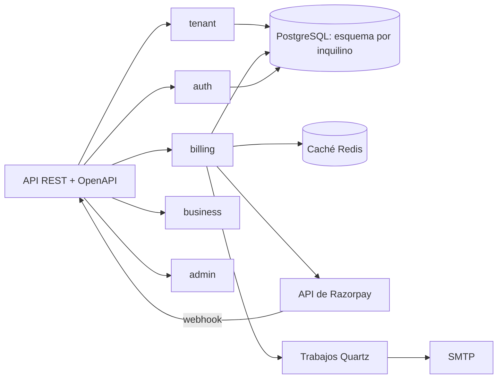

# Billforge

[English](README.md) · **Español**

Una plataforma de facturación multi-tenant para productos SaaS: inquilinos, planes, suscripciones,
prorrateo, facturas y pagos con Razorpay y webhooks verificados por firma, todo en un único
desplegable con un esquema de PostgreSQL por inquilino.

## Qué hace

- **Alta de inquilinos** con su propio esquema, creado y migrado bajo demanda.
- **Planes y precios** con funcionalidades, límites y precios por moneda.
- **Suscripciones** con ciclos de facturación, pruebas, cambios de plan y cancelación.
- **Prorrateo** cuando una suscripción cambia a mitad de ciclo.
- **Facturas** por periodo, con líneas, impuestos y transiciones de estado.
- **Pagos** con Razorpay, webhooks verificados con HMAC y manejo idempotente.
- **Notificaciones** por email a partir de eventos, y trabajos programados con Quartz.
- **Administración**: inquilinos, usuarios, métricas y registro de auditoría.
- **Autenticación** con JWT, refresh rotatorio y permisos por inquilino.

## Arquitectura

Un monolito modular: cada módulo tiene sus entidades, servicios y controladores, y se comunican por
interfaces y eventos de dominio, no accediendo a los repositorios de otros módulos.



**Un esquema por inquilino.** Hibernate resuelve el esquema de cada petición a partir del contexto
del inquilino, y Flyway crea y migra cada esquema al darlo de alta. El esquema `public` guarda los
datos de plataforma: inquilinos, planes, usuarios y auditoría.

Detalle en [docs/](docs/): [arquitectura](docs/01-architecture), [multi-tenancy](docs/02-multi-tenancy),
[seguridad](docs/03-security), [facturación](docs/05-platform-billing), [API](docs/06-api),
[decisiones](docs/12-decisions).

## Inicio rápido

```bash
cp .env.example .env       # define POSTGRES_PASSWORD y los tres valores de Razorpay
docker compose up --build
```

| Qué | URL |
|---|---|
| API | http://localhost:8080 |
| OpenAPI / Swagger UI | http://localhost:8080/swagger-ui.html |
| Salud | http://localhost:8080/actuator/health |

El stack levanta la app, PostgreSQL 16 y Redis 7. La aplicación no arranca sin `POSTGRES_PASSWORD`,
`RAZORPAY_KEY_ID`, `RAZORPAY_KEY_SECRET` ni `RAZORPAY_WEBHOOK_SECRET`.

## Desarrollo local

```bash
docker compose up postgres redis

export DATABASE_URL=jdbc:postgresql://localhost:5432/billforge
export DATABASE_USERNAME=billforge_user
export DATABASE_PASSWORD=...
export REDIS_HOST=localhost REDIS_PORT=6379

./mvnw spring-boot:run -Dspring-boot.run.profiles=dev
```

Requiere Java 21 y el wrapper de Maven. El perfil `dev` activa Flyway y el log de SQL.

## Pruebas

```bash
./mvnw verify
```

La suite cubre pruebas unitarias por servicio, reglas de arquitectura (límites entre módulos) y
pruebas de integración que arrancan la aplicación contra PostgreSQL y Redis: aislamiento entre
inquilinos, flujo de facturación y webhook de Razorpay. La CI levanta ambos servicios; en local,
`docker compose up postgres redis` y crea `billforge_test` como indica
`src/test/resources/application-test.yaml`.

## Tecnologías

| Área | Tecnologías |
|---|---|
| Backend | Java 21, Spring Boot 3.4, Spring Security, Spring Data JPA, Flyway, MapStruct, Quartz |
| Datos | PostgreSQL 16 (esquema por inquilino), Redis |
| Pagos | SDK de Razorpay, webhooks HMAC, claves de idempotencia |
| Documentación | springdoc OpenAPI, 13 secciones de documentación |
| Entrega | Docker Compose, GitHub Actions |

## Estructura del repositorio

```
src/main/java/com/billforge/
  admin/          inquilinos, usuarios, métricas y auditoría
  app/            punto de entrada, filtros y configuración transversal
  auth/           usuarios, roles, JWT y refresh tokens
  billing/        planes, suscripciones, prorrateo, facturas, pagos, webhooks
  business/       clientes, productos y facturas B2B
  notification/   notificaciones por email y plantillas
  shared/         enums, contexto de inquilino, errores y utilidades
  tenant/         ciclo de vida del inquilino, planes y migraciones por esquema
docs/             13 secciones: arquitectura, modelo de datos, eventos, trabajos, decisiones
```

## Limitaciones conocidas

- Un único desplegable: los módulos se separan por paquete e interfaz, no por red.
- Razorpay es el único proveedor de pago; no hay bóveda de tarjetas.
- No hay interfaz web; la API es la superficie del producto.
- El email va directo a SMTP, sin proveedor de entrega ni gestión de rebotes.
- Parte del roadmap original (observabilidad, facturación por uso, manifiestos de Kubernetes) no
  está construido.

## Licencia

MIT. Ver [LICENSE](LICENSE).
