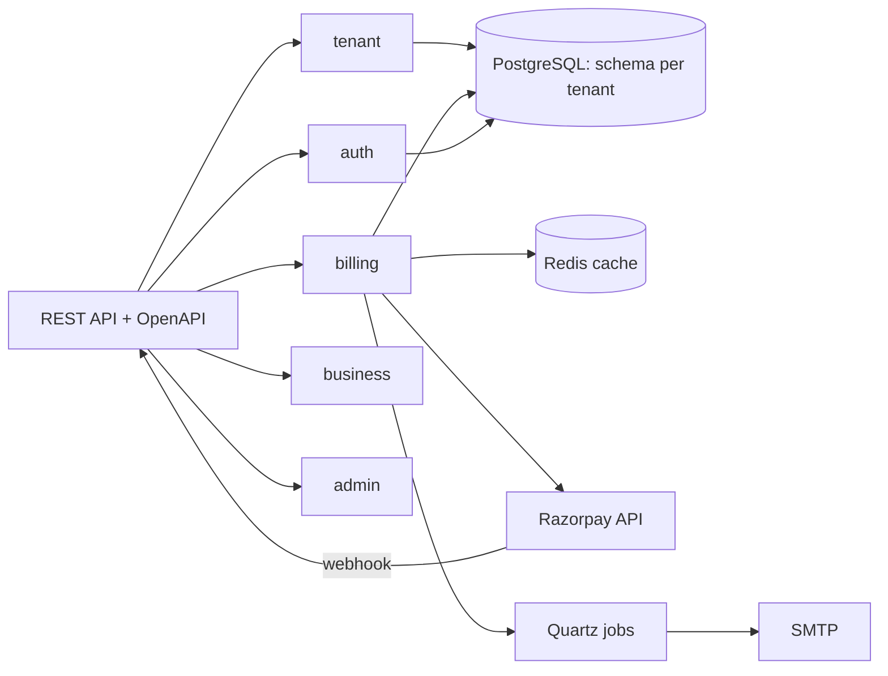

# Billforge

[English](README.md) · [Español](README.es.md)

A multi-tenant billing platform for SaaS products: tenants, plans, subscriptions, proration,
invoices, payments through Razorpay and signature-verified webhooks, on one deployable with a
PostgreSQL schema per tenant.

## What it does

- **Tenant onboarding** with its own schema, created and migrated on demand.
- **Plans and pricing** with features, limits and prices per currency.
- **Subscriptions** with billing cycles, trials, plan changes and cancellation.
- **Proration** when a subscription changes mid-cycle.
- **Invoices** per period, with line items, taxes and status transitions.
- **Payments** through Razorpay, with HMAC-verified webhooks and idempotent handling.
- **Notifications** by email from domain events, plus scheduled jobs through Quartz.
- **Administration**: tenants, users, metrics and audit log.
- **Authentication** with JWT access tokens, rotating refresh tokens and permissions per tenant.

## Architecture

A modular monolith: each module owns its entities, services and controllers, and modules talk
through service interfaces and domain events rather than each other's repositories.



**Schema per tenant.** Hibernate resolves the schema for every request from the tenant context, and
Flyway creates and migrates each tenant schema when the tenant is provisioned. The `public` schema
holds platform data: tenants, plans, users and the audit log.

Details in [docs/](docs/): [architecture](docs/01-architecture), [multi-tenancy](docs/02-multi-tenancy),
[security](docs/03-security), [billing](docs/05-platform-billing), [API](docs/06-api),
[decisions](docs/12-decisions).

## Quick start

```bash
cp .env.example .env       # set POSTGRES_PASSWORD and the three Razorpay values
docker compose up --build
```

| What | URL |
|---|---|
| API | http://localhost:8080 |
| OpenAPI / Swagger UI | http://localhost:8080/swagger-ui.html |
| Health | http://localhost:8080/actuator/health |

The stack starts the app, PostgreSQL 16 and Redis 7. The app refuses to start without
`POSTGRES_PASSWORD`, `RAZORPAY_KEY_ID`, `RAZORPAY_KEY_SECRET` and `RAZORPAY_WEBHOOK_SECRET`.

## Local development

```bash
docker compose up postgres redis

export DATABASE_URL=jdbc:postgresql://localhost:5432/billforge
export DATABASE_USERNAME=billforge_user
export DATABASE_PASSWORD=...
export REDIS_HOST=localhost REDIS_PORT=6379

./mvnw spring-boot:run -Dspring-boot.run.profiles=dev
```

Java 21 and the Maven wrapper are required. The `dev` profile enables Flyway and SQL logging.

## Testing

```bash
./mvnw verify
```

The suite covers unit tests per service, architecture rules (module boundaries) and integration
tests that boot the application against PostgreSQL and Redis: tenant isolation, the billing flow and
the Razorpay webhook. CI provides both services; locally, start them with
`docker compose up postgres redis` and create `billforge_test` as described in
`src/test/resources/application-test.yaml`.

## Tech stack

| Area | Technologies |
|---|---|
| Backend | Java 21, Spring Boot 3.4, Spring Security, Spring Data JPA, Flyway, MapStruct, Quartz |
| Data | PostgreSQL 16 (schema per tenant), Redis |
| Payments | Razorpay Java SDK, HMAC webhooks, idempotency keys |
| Docs | springdoc OpenAPI, 13 documentation sections |
| Delivery | Docker Compose, GitHub Actions |

## Repository layout

```
src/main/java/com/billforge/
  admin/          tenants, users, metrics and audit
  app/            entry point, filters and cross-cutting configuration
  auth/           users, roles, JWT and refresh tokens
  billing/        plans, subscriptions, proration, invoices, payments, webhooks
  business/       customers, products and business invoices
  notification/   email notifications and templates
  shared/         enums, tenant context, errors and utilities
  tenant/         tenant lifecycle, plans and per-tenant Flyway migrations
docs/             13 sections: architecture, data model, events, jobs, decisions
```

## Known limitations

- One deployable: modules are separated by package and interface, not by network boundary.
- Razorpay is the only payment provider; there is no card vaulting.
- No web interface; the API is the product surface.
- Email goes to SMTP directly, without a delivery provider or bounce handling.
- Some roadmap items from the original notes (observability stack, usage-based billing,
  Kubernetes manifests) are not built.

## License

MIT. See [LICENSE](LICENSE).
